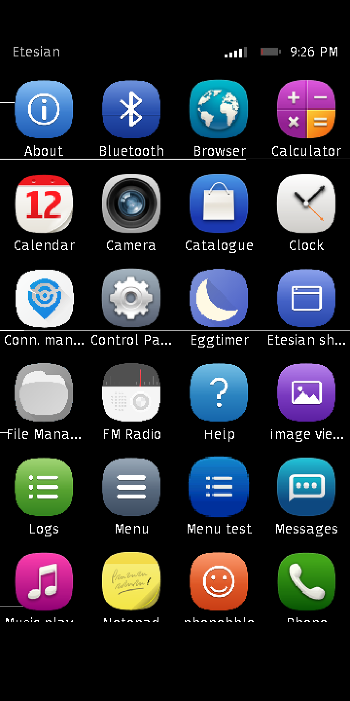
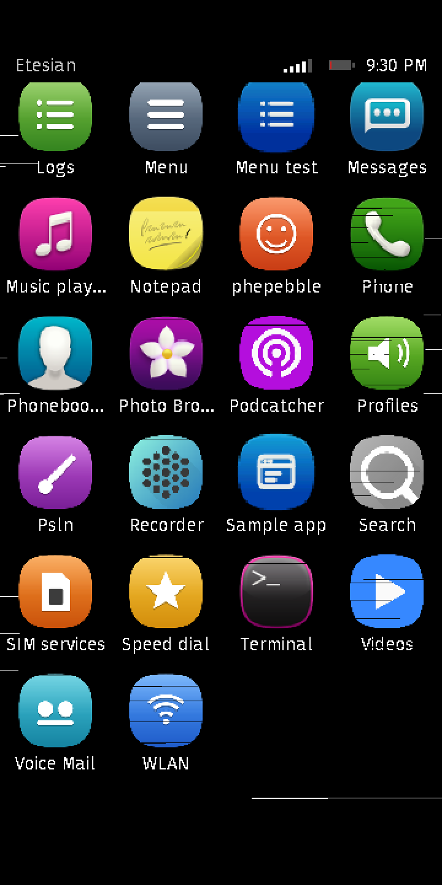
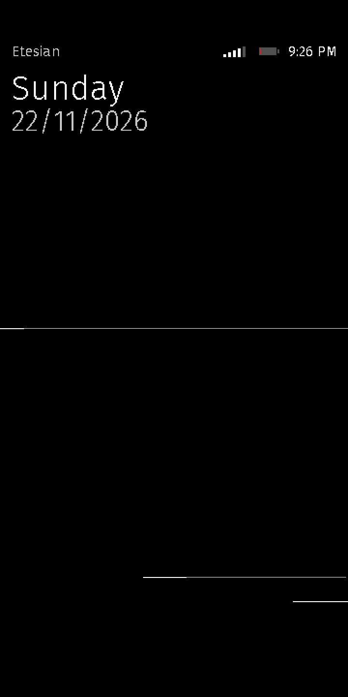
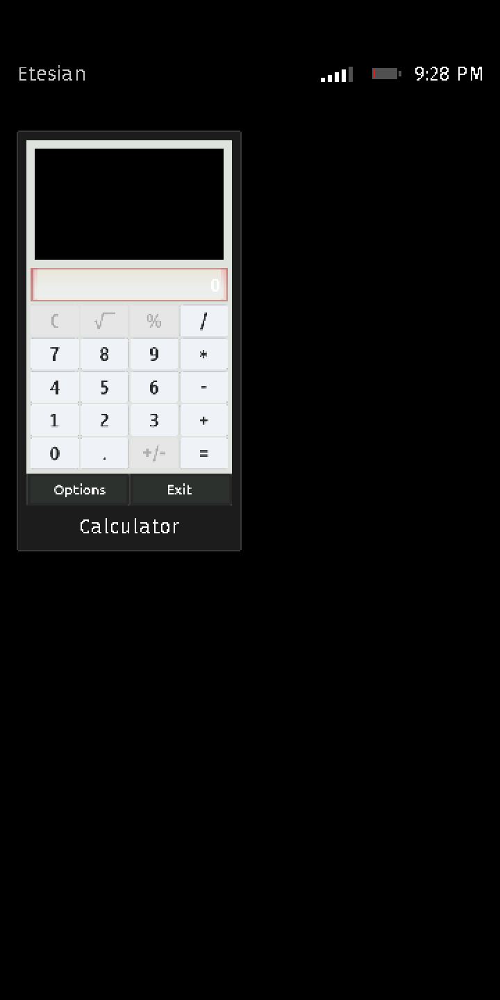
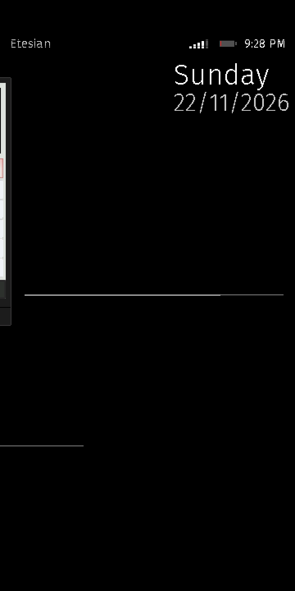
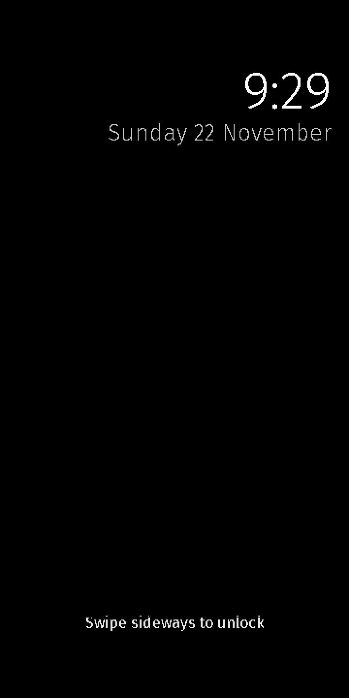
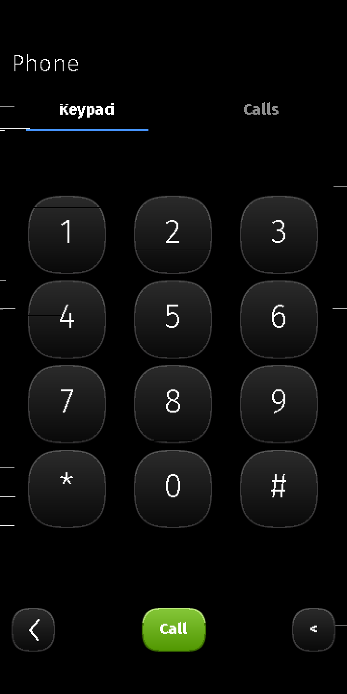
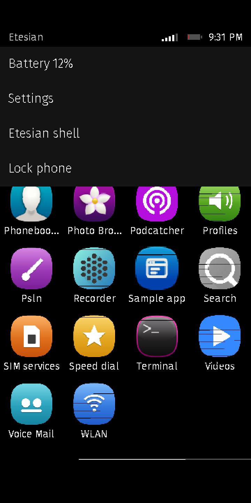
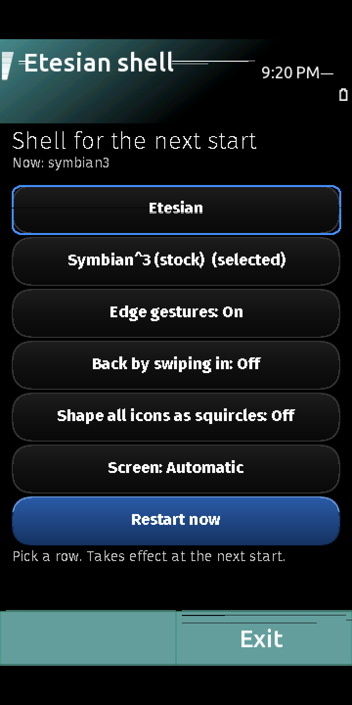
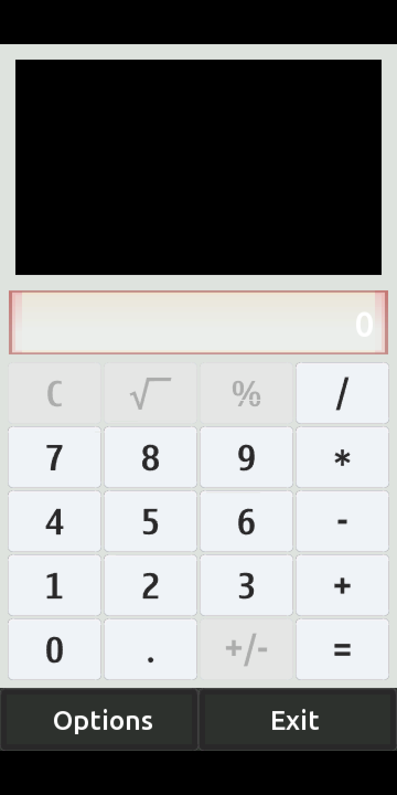

# Etesian shell

An early second shell for the Symbian^3 UI in the [Etesian](https://github.com/etesian-design/design) design language (the N9's look,
re-envisioned): a home screen with an app grid, Open apps and an events page, and a dialler. It installs on top of the standard UI
(Catalogue: `etesian-ui`) and nothing in the phone needs it.

- Open the **Etesian shell** app, pick Etesian and restart. Pick Symbian^3 the same way to go back.
- If Etesian does not start twice in a row, the phone falls back to Symbian^3 by itself.
- Choosing the shell activates the **Etesian theme** and switching back restores the theme you had. The theme and its typeface (Fira Sans)
  are not part of this package: the Phorepoc OS images carry them
  ([etesian-theme](https://github.com/Phorepoc/etesian-theme), built into the ROM); on other phones install the "Etesian theme" package first.
- Removing the package removes the shell, also while Etesian is running (the phone then shows Symbian^3); switching back first is still the tidy way.

Build (the pdk's package.yml does this from `package.conf`; `release.yml` publishes `etesian-ui-arm.sis` and `etesian-ui-x32.sis`):

    PHOREPOC_PDK=<pdk> PHOREPOC_BUILD=<out> bash recipes/sis.sh

## Screenshots

Etesian on Phorepoc OS (x32, 720 x 1440) with the [Etesian theme](https://github.com/Phorepoc/etesian-theme).

| | | |
|---|---|---|
|  |  |  |
| Applications | Applications, scrolled | Events |
|  |  |  |
| Open apps, with a running app | The three pages are one strip: mid-swipe | Lock screen |
|  |  |  |
| Dialler | Status menu | Etesian shell settings |
|  | | |
| Calculator in the Etesian theme | | |

Licence: AGPL-3.0-only (`LICENSE`), with the additional terms of `ADDITIONAL-TERMS.md`. This shell is our implementation
of the [Etesian Design Language](https://github.com/Etesian-design/design) shell and carries the same terms as the upstream:
the section 7(b) attribution "Etesian, founded by Kyriakos Bompotis", which must stay in the `NOTICE` and wherever a derived
work shows its legal notices; section 7(e), the Etesian names and logos (`TRADEMARKS.md`); and the Phorepoc exception, under
which the Phorepoc images and packages use it. Anyone else uses it under the AGPL. The SIS installs `LICENSES/` and `NOTICE`
in `\resource\etesian\ui\licences\`.
